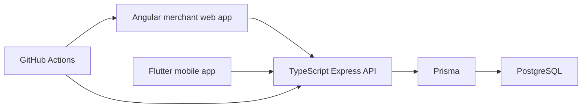

[Français](docs/CASE_STUDY.fr.md) · [Philippe Le Goff](https://github.com/PhilLeGoff) · [Portfolio](https://www.webbyphil.net/)

# Reflexx

A cross-platform loyalty product connecting merchant management interfaces, mobile customer journeys and a shared API. This case study focuses on the engineering of account access, loyalty transactions and delivery.

**Angular · Flutter · TypeScript · Node.js · Express · Prisma · PostgreSQL**

Loyalty statistics dashboard

*Real dashboard captured at localhost:4200 with synthetic browser fixtures. The merchant, charts and figures are demonstration data, not actual customers or product usage.*

## What it does

- Merchant programs, point balances, rewards and QR workflows.
- Web and mobile account journeys with role-based access.
- Transaction-safe point operations and an auditable loyalty history.
- Coordinated application delivery with database migrations and deployment workflows.

## Architecture

## My contribution

I co-build Reflexx with two other engineers within a four-person venture, and coordinate the engineering team and technical roadmap. My work spans web/mobile journeys and API integration, including account access and loyalty workflows. The product is collaborative; this case study does not imply sole ownership of its code.

## Running and inspecting the project

No application source or hosted demo is distributed in this repository. The private development environment contains separate Angular, Flutter and Node.js applications backed by PostgreSQL. The screenshots show the real merchant dashboard rendered locally with synthetic data. No real account operations or backend data were used.

## Current state and limitations

Production infrastructure is deployed, while product areas remain at beta/pilot maturity. There are currently no customers or active users. This repository publishes the case study only; application source and operational configuration remain private.

## Credits

Reflexx is built by three engineers within a four-person venture. This documentation describes Philippe’s contribution and retains the collaborative product context.
