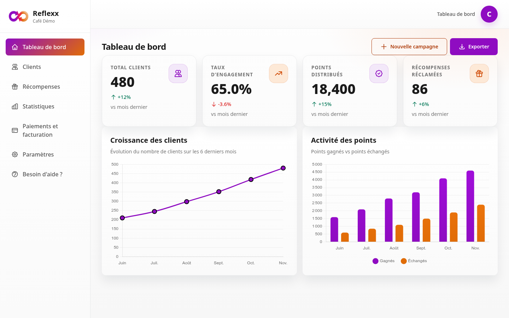
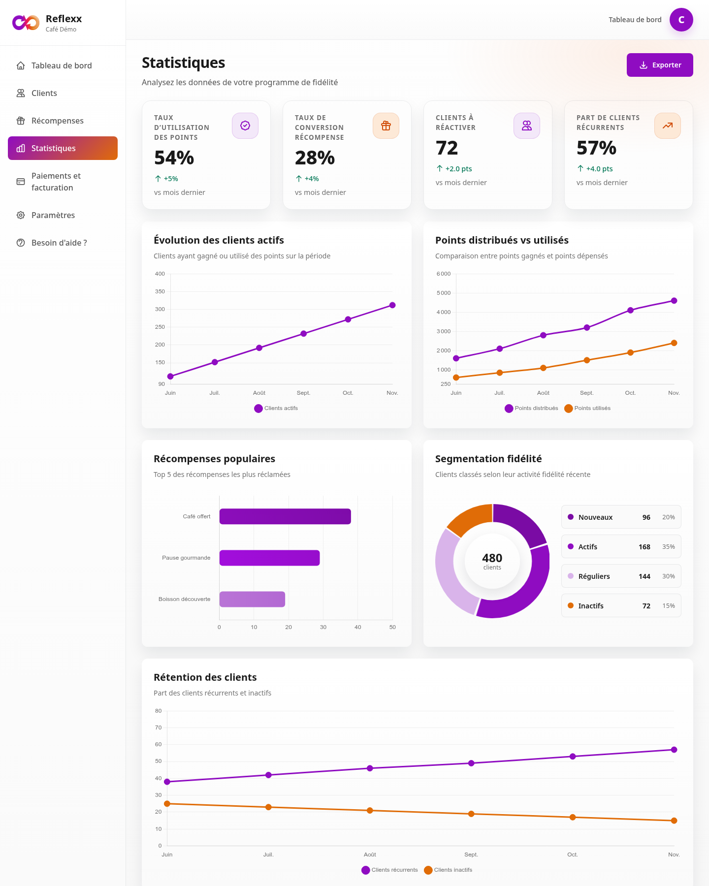
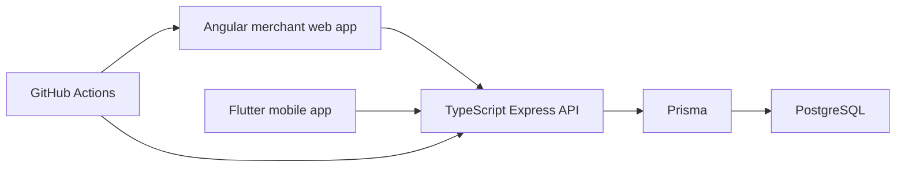

# Reflexx

**Une plateforme de fidélité entre web, mobile et API.**

[English](../README.md) · [Portfolio](https://www.webbyphil.net/)

Un produit de fidélité qui relie les interfaces commerçants, les parcours mobiles clients et une API commune. Cette étude de cas porte sur les comptes, les transactions de fidélité et la mise en production.

**Angular · Flutter · TypeScript · Node.js · Express · Prisma · PostgreSQL**

Statistiques de fidélité

*Interface réelle capturée sur localhost:4200 avec des données de démonstration. Le commerce, les graphiques et les chiffres sont fictifs ; ils ne représentent ni clients réels ni usage du produit.*

## Fonctionnalités

- Programmes commerçants, soldes de points, récompenses et parcours QR.
- Parcours de compte web et mobile avec contrôle d’accès par rôle.
- Opérations de points transactionnelles et historique de fidélité traçable.
- Livraison coordonnée des applications, migrations et déploiements.

## Architecture

## Ma contribution

Je co-développe Reflexx avec deux autres ingénieurs au sein d’un projet entrepreneurial de quatre personnes, et je coordonne l’équipe technique et sa feuille de route. Mon travail couvre les parcours web/mobile et leur intégration API, notamment les comptes et la fidélité. Le produit est collaboratif.

## Installation et consultation

Ce dépôt ne distribue ni le code applicatif ni une démonstration hébergée. L’environnement privé contient les applications Angular, Flutter et Node.js, adossées à PostgreSQL. Les captures représentent le tableau de bord commerçant réel, exécuté localement avec des données fictives, sans lecture de comptes réels ni usage client revendiqué.

## État actuel et limites

L’infrastructure est déployée en production, tandis que les différentes parties du produit restent au stade bêta/pilote. Il n’y a actuellement ni clients ni utilisateurs actifs. Ce dépôt publie uniquement l’étude de cas ; le code et la configuration opérationnelle restent privés.

Les crédits et références d’origine sont conservés dans le [README principal](../README.md#credits).
